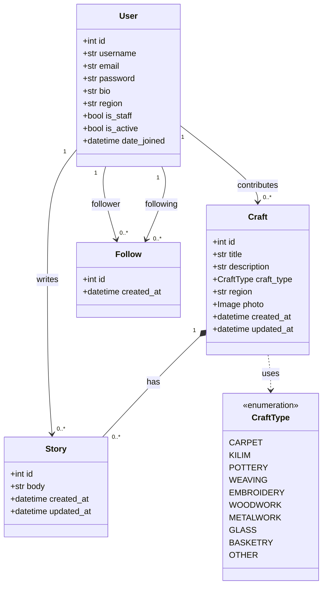
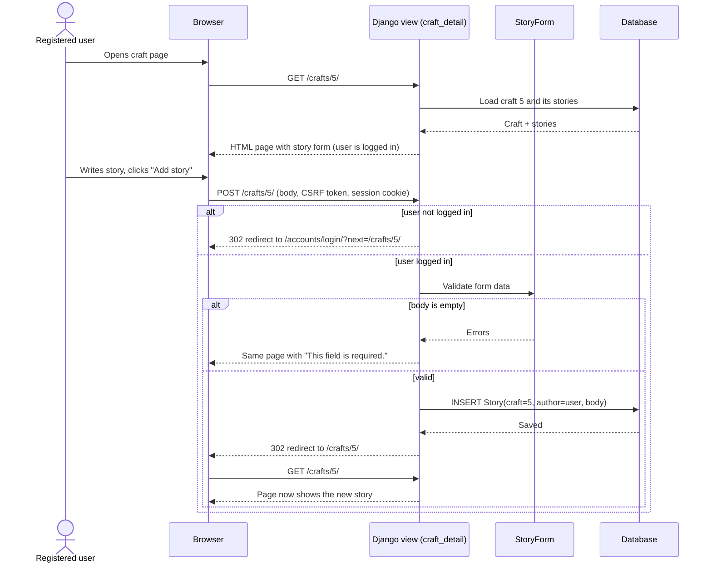

# Design — Craft Heritage Archive

This document describes the planned design. It is updated whenever the implementation changes, so it always matches the code.

## 1. Architecture

One Django project with one app (`archive`). The same models serve two interfaces:

- **Web interface**: Django views and templates (server-rendered HTML).
- **REST API**: Django REST Framework views under `/api/`, documented by drf-spectacular at `/api/docs/` (Swagger UI).

```
Browser ──HTML──> Django views + templates ─┐
                                             ├──> Models (ORM) ──> SQLite (local) / PostgreSQL (Render)
API client ─JSON─> DRF views + serializers ──┘
```

Planned dependencies (each must be explainable):

| Package | Why |
|---|---|
| Django | Web framework, ORM, auth, admin, forms, templates. |
| djangorestframework | REST API, serializers, token authentication. |
| drf-spectacular | Generates the OpenAPI schema and Swagger UI. |
| Pillow | Required by Django's `ImageField` to validate photos. |
| gunicorn | Production WSGI server in Docker/Render (`runserver` is not for production). |
| psycopg | PostgreSQL driver for production. |
| whitenoise | Serves static files (CSS, admin) in production without a separate web server. |

## 2. Data model

`User` is a custom user model extending Django's `AbstractUser`. Django's documentation recommends starting every new project with a custom user model, because changing it later is hard. It only adds two fields.

| Model | Field | Type | Notes |
|---|---|---|---|
| **User** | (inherited) | `AbstractUser` | username, email, password (hashed), is_staff, is_active, date_joined |
| | bio | `TextField(blank=True)` | |
| | region | `CharField(max_length=100, blank=True)` | |
| **Craft** | title | `CharField(max_length=200)` | |
| | description | `TextField` | |
| | craft_type | `CharField(max_length=20, choices=CraftType.choices)` | carpet, kilim, pottery, weaving, embroidery, woodwork, metalwork, glass, basketry, other |
| | region | `CharField(max_length=100)` | free text, e.g. "Uşak, Aegean" |
| | photo | `ImageField(upload_to="crafts/")` | max 5 MB (validated in form/serializer) |
| | contributor | `ForeignKey(User, on_delete=CASCADE, related_name="crafts")` | set automatically to the logged-in user |
| | created_at | `DateTimeField(auto_now_add=True)` | |
| | updated_at | `DateTimeField(auto_now=True)` | |
| | Meta | `ordering = ["-created_at"]` | newest first |
| **Story** | craft | `ForeignKey(Craft, on_delete=CASCADE, related_name="stories")` | |
| | author | `ForeignKey(User, on_delete=CASCADE, related_name="stories")` | set automatically |
| | body | `TextField` | the making story |
| | created_at | `DateTimeField(auto_now_add=True)` | |
| | updated_at | `DateTimeField(auto_now=True)` | |
| | Meta | `ordering = ["created_at"]` | oldest first; Final: `UniqueConstraint(craft, author)` |
| **Follow** | follower | `ForeignKey(User, on_delete=CASCADE, related_name="following")` | the user who follows |
| | following | `ForeignKey(User, on_delete=CASCADE, related_name="followers")` | the user being followed |
| | created_at | `DateTimeField(auto_now_add=True)` | |
| | Meta | `UniqueConstraint(follower, following)`, `CheckConstraint(follower != following)` | no duplicates, no self-follow (enforced by the database) |

Why an explicit `Follow` model instead of a `ManyToManyField`: it stores `created_at`, its constraints are visible in one place, and it appears as its own table in the admin.

### 2.1 Class diagram



## 3. Use cases

Actors: **Visitor** (not logged in), **Registered user**, **Moderator** (staff), **API client**.

| ID | Use case | Actor | Main flow | Stories |
|---|---|---|---|---|
| UC-01 | Register | Visitor | Fill sign-up form → account created → logged in | US-ACC-01–03, 09 |
| UC-02 | Log in / log out | Registered user | Enter credentials → session starts; click Log out → session ends | US-ACC-04–06 |
| UC-03 | Obtain API token | API client | POST credentials → receive token | US-ACC-08 |
| UC-04 | Browse crafts | Visitor | Open home page → see paginated craft cards | US-CRA-07, 08 |
| UC-05 | View craft and its stories | Visitor | Click a craft → see details and making stories | US-CRA-09, US-STO-04 |
| UC-06 | Add a craft | Registered user | Open "Add craft" → fill fields and photo → saved → detail page | US-CRA-01–06 |
| UC-07 | Edit / delete own craft | Registered user | Open own craft → edit or delete | US-CRA-11–13 |
| UC-08 | Add a making story | Registered user | On a craft page → write story → saved and shown | US-STO-01–05 |
| UC-09 | Edit / delete own story | Registered user | On own story → edit or delete | US-STO-07–09 |
| UC-10 | View a profile | Visitor | Click a username → profile with crafts, stories, counts | US-PRO-01–04 |
| UC-11 | Follow / unfollow a user | Registered user | On a profile → click Follow / Unfollow | US-FOL-01–05 |
| UC-12 | View feed | Registered user | Click "Feed" → crafts by followed users | US-FEE-01–07 |
| UC-13 | Search and filter crafts | Visitor | Choose type, enter region or keyword → filtered list | US-SEA-01–07 |
| UC-14 | Moderate content | Moderator | Log in to `/admin/` → delete content or deactivate a user | US-MOD-01–05 |

## 4. API endpoints

Authentication: `Token <key>` header (DRF `TokenAuthentication`) or the browser session. "Public" means no authentication is needed. All list endpoints are paginated (12 per page).

| Method | URL | Auth | Description | FR | MVP |
|---|---|---|---|---|---|
| POST | `/api/auth/register/` | Public | Create an account | FR-01 | Yes |
| POST | `/api/auth/token/` | Public | Get a token for username + password (DRF `obtain_auth_token`) | FR-04 | Yes |
| GET | `/api/users/{username}/` | Public | Public profile with counts | FR-05 | Yes |
| GET, PATCH | `/api/users/me/` | Token | Read / update own profile | FR-06 | No |
| GET | `/api/crafts/` | Public | List crafts; query params `craft_type`, `region`, `search`, `page` | FR-08, FR-20–23 | Yes |
| POST | `/api/crafts/` | Token | Create a craft (multipart, with photo) | FR-07 | Yes |
| GET | `/api/crafts/{id}/` | Public | Craft detail | FR-09 | Yes |
| PATCH, DELETE | `/api/crafts/{id}/` | Token (owner) | Edit / delete own craft | FR-10 | No |
| GET | `/api/crafts/{id}/stories/` | Public | List stories of a craft, oldest first | FR-15 | Yes |
| POST | `/api/crafts/{id}/stories/` | Token | Add a making story | FR-13 | Yes |
| PATCH, DELETE | `/api/stories/{id}/` | Token (author) | Edit / delete own story | FR-14 | No |
| POST | `/api/users/{username}/follow/` | Token | Follow a user (201; 200 if already following; 400 for self) | FR-16 | Yes |
| DELETE | `/api/users/{username}/follow/` | Token | Unfollow a user (204) | FR-16 | Yes |
| GET | `/api/users/{username}/followers/` | Public | List followers | FR-17 | No |
| GET | `/api/users/{username}/following/` | Public | List followed users | FR-17 | No |
| GET | `/api/feed/` | Token | Crafts by followed users, newest first | FR-18 | Yes |
| GET | `/api/schema/` | Public | OpenAPI schema (drf-spectacular) | FR-26 | Yes |
| GET | `/api/docs/` | Public | Swagger UI (drf-spectacular) | FR-26 | Yes |

### 4.1 Web pages (Django templates)

| URL | Page | Auth | MVP |
|---|---|---|---|
| `/` | Craft list with type/region filters | Public | Yes |
| `/crafts/new/` | Add craft form | Login | Yes |
| `/crafts/{id}/` | Craft detail, stories, add-story form | Public (form: login) | Yes |
| `/crafts/{id}/edit/`, `/crafts/{id}/delete/` | Edit / delete own craft | Owner | No |
| `/users/{username}/` | Profile with follow button | Public | Yes |
| `/users/{username}/follow/` | POST only: follow / unfollow toggle | Login | Yes |
| `/feed/` | Personal feed | Login | Yes |
| `/accounts/signup/` | Sign-up form (`UserCreationForm`) | Public | Yes |
| `/accounts/login/`, `/accounts/logout/` | Django's built-in auth views | Public | Yes |
| `/admin/` | Django admin for moderators | Staff | Yes |

## 5. Sequence diagram — add a making story

Web flow (the API flow is the same, with `POST /api/crafts/{id}/stories/`, a token instead of the session, and a JSON response instead of a redirect).



## 6. Deployment

- **Local**: `python manage.py runserver` with SQLite.
- **Docker**: one `Dockerfile` (Python slim image → install requirements → `collectstatic` → run gunicorn).
- **Render**: web service built from the Dockerfile plus a Render PostgreSQL database. Settings read `SECRET_KEY`, `DEBUG`, `ALLOWED_HOSTS` and the database connection from environment variables.
- **Photo storage**: open decision, see risk R1 in [elicitation.md](elicitation.md).
